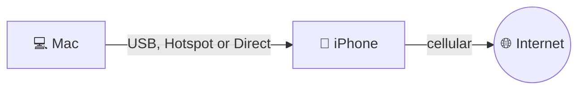

<p align="center">
  
</p>

<h1 align="center">Nothering – is not tethering</h1>

<p align="center">
  Use your iPhone's cellular connection from your Mac through a small proxy on the phone.
</p>

<p align="center">
  <a href="https://apps.apple.com/app/nothering/id6817766239"></a>
  <a href="https://testflight.apple.com/join/GYV2fdtp"></a>
  <a href="https://github.com/devxoul/nothering/releases/latest"></a>
</p>

---

> [!NOTE]
> **This is a fork** of [devxoul/nothering](https://github.com/devxoul/nothering). It adds the **direct link**: the Mac uses the iPhone's connection with **no Personal Hotspot, no cable and no Wi-Fi network** to join, for instance in a car. The Mac starts the iPhone's app over Bluetooth, so the iPhone stays in the pocket, and neither side needs a paid developer account or a weekly reinstall.
>
> **[Install it →](docs/direct-link.md#install)** &nbsp;·&nbsp; [What has and hasn't been run](docs/direct-link.md#what-has-and-hasnt-been-run): it has not run on an iPhone yet.
>
> The badges above are the original's. Its iPhone app has no direct link.

## What it does

The iPhone runs a small **SOCKS5 proxy**, and every connection your Mac makes is **re-opened from the iPhone's own network stack** over cellular.

On the Mac, a **transparent proxy system extension** captures app traffic (TCP, UDP and DNS) and sends it to the phone over **USB**, the **Personal Hotspot** link, or **directly over Wi-Fi** with no hotspot and no cable. No per-app proxy settings needed.

## How it works



| Piece | Role |
|---|---|
| **iPhone app** | SOCKS5 server (CONNECT + framed UDP) on port `11080`. Accepts clients only from loopback and hotspot (`bridge*`) interfaces, plus a Mac paired for the direct link, and pins outbound connections to cellular. Plays silent audio to stay alive in the background. |
| **Mac menu bar app** | Owns the link to the phone — prefers USB, falls back to the hotspot gateway, or uses the direct link when chosen — and serves it on `127.0.0.1:11080`. Installs and toggles the extension. |
| **Mac proxy extension** | `NETransparentProxyProvider` + `NEDNSProxyProvider`. Relays outbound flows via SOCKS5; resolves public DNS over TCP through the phone. |
| **`nothering` CLI** | Minimal alternative to the menu bar app: a local SOCKS5 forwarder, optionally set as the system SOCKS proxy. |

### What goes direct

Nothering fails open — your Mac keeps working when the phone isn't around.

- 🔌 **Phone unreachable** → flows and DNS go direct.
- 🏠 **Local networks** (RFC 1918, link-local, CGNAT, ULA, multicast) are never captured.
- 🛡️ **Other VPNs / network extensions** are left alone — except Tailscale's TCP (control plane + DERP), so your tailnet keeps working when the network blocks WireGuard UDP. Tailnet DNS names resolve normally.

## Getting started

### Install

- **With the direct link** — see [`docs/direct-link.md`](docs/direct-link.md#install): this fork's iPhone app through SideStore, and its `nothering` tool on the Mac.
- **The original, with a cable or the hotspot** — the iPhone app from the [App Store](https://apps.apple.com/app/nothering/id6817766239), the Mac app and CLI from the [original's releases](https://github.com/devxoul/nothering/releases/latest).

### Requirements

- Xcode with the iOS 18 / macOS 15 SDKs
- [Tuist](https://tuist.dev)
- An Apple Developer team (system extensions and Network Extension entitlements need signing)

### Build

```sh
tuist generate  # creates Nothering.xcworkspace
```

Set your own `teamID` (and optionally `bundleIDPrefix`) in [`Project.swift`](Project.swift) first.

| Scheme | Product |
|---|---|
| `NotheringiOS` | iPhone app |
| `NotheringMenuBar` | Mac menu bar app (embeds the extension) |
| `NotheringMac` | `nothering` CLI |
| `ProxyCore`, `PhoneLink` | Libraries + unit tests (`tuist test ProxyCore`) |

### Release

Releases go through [fastlane](https://fastlane.tools) with [match](https://docs.fastlane.tools/actions/match/) handling signing. Set these in the environment or in `fastlane/.env`:

| Variable | Purpose |
|---|---|
| `MATCH_GIT_URL`, `MATCH_PASSWORD` | Private certificates repo and its passphrase |
| `APP_STORE_CONNECT_API_KEY_KEY_ID`, `APP_STORE_CONNECT_API_KEY_ISSUER_ID`, `APP_STORE_CONNECT_API_KEY_KEY_FILEPATH` | App Store Connect API key (`.p8`) |
| `APP_REVIEW_PHONE_NUMBER` | App Review contact phone. Optional locally: App Store Connect keeps the current number |
| `SPARKLE_PRIVATE_KEY` | Signs the Mac app's update feed. Optional locally: falls back to the `app.nothering` keychain item from Sparkle's `generate_keys` |

```sh
bundle install
bundle exec fastlane release      # both below, sharing one build number
bundle exec fastlane ios beta     # iPhone app → TestFlight (build number = latest + 1)
bundle exec fastlane mac release  # Mac app + CLI → Developer ID, notarized zips in build/fastlane/
```

`ios beta` and `mac release` accept `build_number:<n>`. Set `MATCH_READONLY=true` to stop match from creating new certificates or profiles.

Published releases go through the **Release** GitHub Actions workflow (`gh workflow run release.yml -f version=X.Y.Z`): it uploads the iPhone app to TestFlight and attaches the notarized Mac app and CLI to a GitHub Release. See [`AGENTS.md`](AGENTS.md#release) for the full process.

### Use

1. **iPhone** — open Nothering and tap **Start Proxy**.
2. **Connect** the Mac by USB cable or join the iPhone's Personal Hotspot. With neither, use the [direct link](#direct-link-no-hotspot-no-cable).
3. **Mac** — launch the menu bar app. It copies itself to `/Applications` (required for system extensions) and asks to install the extension; approve it in **System Settings → General → Login Items & Extensions**.
4. Flip the switch in the menu bar panel. The icon lights up while traffic is captured.

 on &nbsp;·&nbsp;  off

The panel shows the active link, traffic counters, and lets you force **USB**, **Hotspot** or **Direct**. Scripts can toggle capture with URLs:

```sh
open nothering://on
open nothering://off
```

### Direct link (no hotspot, no cable)

The Mac reaches the phone over Apple's device-to-device Wi-Fi, the one AirDrop uses. It needs no Personal Hotspot on the plan, no shared network and no cable. Wi-Fi has to be on, on both, joined to a network or not.

Once:

1. **iPhone** — open Nothering and leave it open. The proxy starts by itself (**Start when opened**). Allow local network access and Bluetooth when iOS asks.
2. **Mac** — run `nothering --via direct`, or in the menu bar panel set **Connect iPhone via** to **Direct**. The iPhone asks whether to allow this Mac, and both show the same number: tap **Allow** on the iPhone, then confirm on the Mac that it did show that number. The second answer is what keeps another device in range from answering in the iPhone's place.

After that the iPhone needn't be touched: `nothering --via direct --wake`, or switching Nothering on in the Mac's menu bar, wakes the app on the iPhone over Bluetooth, the proxy starts, and the Mac connects. Stopping it lets the iPhone go, and its proxy stops by itself. Opening Nothering on the iPhone does the same from that side. The Mac finds the phone again after it was out of range for a moment. After about 45 seconds without the Mac, the iPhone's proxy stops, and it takes the wake to start it again; a Mac that asked for it over Bluetooth meanwhile gets two minutes from its request. **Auto** never picks this link, and the Mac only wakes the iPhone while it is asked to: a phone that is merely nearby would otherwise move a Mac on its usual Wi-Fi onto cellular data. Tapping Stop on the iPhone ends it on the Mac too. The menu bar app holds this link only while it is switched on, or set to turn on and off with the iPhone's proxy: the iPhone's proxy never stops while a Mac is linked, so a Mac that held the link for nothing would keep it running for as long as the two are near. When a wake is heard and still no link comes of it, the Mac asks less and less often.

The wake reaches the app while it is in the background or was ended by iOS to free memory. It doesn't reach an app that was swiped away in the app switcher: open it once again after that.

Once a Mac is paired, another one can only ask after **Pair Another Mac** was tapped on the iPhone, which also starts the proxy if it was stopped. A Mac that leaves meanwhile, or in the two minutes after **Allow** before the new one has connected, doesn't stop it. If pairing doesn't work, the iPhone has a **Pairing code** under Connect from Mac that can be typed into the Mac instead: `--code` for the tool, **Type the Code Instead** in the menu bar panel, where **Forget** drops a code that was mistyped. **New Pairing Code** on the iPhone retires it, for a Mac that shouldn't get in any more.

#### With no network at all (a car, a train)

This link is for exactly that: the two talk over the Wi-Fi radio directly and join no network, so Wi-Fi only has to be switched on. But a Mac on no network tells its apps they are offline and has no DNS server to ask, so nothing tries to connect and there is nothing to send through the iPhone. A small helper gives the Mac a stand-in network while the iPhone is linked and in use, and takes it away when the link ends or a real network comes up. It needs an administrator's password once, to install:

```sh
nothering --install-helper
```

The menu bar app offers the same with **Install Helper…** when it finds the Mac on no network. See [`OfflineNetwork.swift`](PhoneLink/Sources/OfflineNetwork.swift). With `--system-proxy` the stand-in network also carries the system's proxy setting, so browsers and most apps reach the iPhone with nothing else installed. For the original Mac app with a cable, [`scripts/car-mode`](scripts/car-mode) installs the same helper and a watcher that brings it up and down.

How it works: the phone advertises a Bonjour service (`_nothering._tcp`) while the proxy runs, under a name made from the pairing code, so a Mac finds its own phone among several. The Mac makes one TLS connection to it, keyed by the phone's pairing code, since there is no Wi-Fi password to keep others in radio range out. Every proxied connection is then a stream on that connection, see [`Mux.swift`](ProxyCore/Sources/Mux.swift), because setting up a new connection over this link is too slow to do per request. Pairing gives the Mac that code without typing: the two agree on a secret over a plain connection, show a number derived from it for the person to compare, each bound to it before either can know it, and the phone sends the code sealed with it, see [`DirectLinkPairing.swift`](ProxyCore/Sources/DirectLinkPairing.swift). The wake is a small Bluetooth service the phone's app keeps reachable while suspended: the Mac reads a challenge from it and writes back an answer only the pairing code gives, see [`DirectLinkWake.swift`](ProxyCore/Sources/DirectLinkWake.swift).

### CLI

```sh
nothering [--via auto|usb|hotspot|direct] [--wake] [--pair] [--code <pairing code>] [--port 11080] [--host <phone address>] [--system-proxy]
```

Forwards `127.0.0.1:<port>` to the phone. `--system-proxy` sets macOS's SOCKS proxy for the duration and restores it on exit. It ends by itself when the proxy is stopped on the iPhone. If the process dies without cleanup:

```sh
networksetup -setsocksfirewallproxystate <service> off
```

## Project layout

```
iOS/         iPhone app (SwiftUI) — proxy controller, background keeper
ProxyCore/   Shared SOCKS5 server, local forwarder, UDP framing, direct link and its stream mux
PhoneLink/   Mac-side links: usbmux, hotspot gateway, SOCKS5/DNS clients
MacApp/      Menu bar app — extension controller, phone forwarder
MacProxy/    System extension — transparent proxy + DNS proxy
Mac/         `nothering` CLI
scripts/     failsafe.sh, car mode for the released Mac app, the fork's build and installers
Shared/      App icon (Icon Composer)
```

### UDP over a stream

The links to the phone only carry streams, so UDP rides inside the SOCKS5 TCP connection using a custom command (`0x83`). Each datagram is one frame:

```
length (UInt16 BE) | ATYP | address | port | payload
```

See [`DatagramFrame.swift`](ProxyCore/Sources/DatagramFrame.swift).

## Development tips

Changing network settings on your only uplink is risky. [`scripts/failsafe.sh`](scripts/failsafe.sh) applies a change and auto-reverts unless you confirm it, or if connectivity checks fail three times in a row:

```sh
scripts/failsafe.sh 'open nothering://on' 'open nothering://off' 120
# happy with it?
touch /tmp/nothering-failsafe.confirm
```

Logs use the `app.nothering` subsystem:

```sh
log stream --predicate 'subsystem == "app.nothering"'
```

## License

[MIT](LICENSE)
